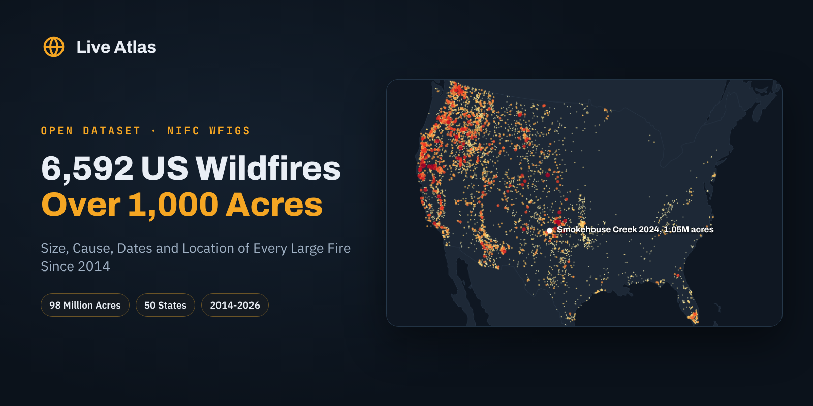

# US Wildfires Over 1,000 Acres



**English first, version française plus bas, resumen en español al final.**

## Every US Wildfire of 1,000 Acres or More Since 2014

A few fires do most of the burning. This dataset lists the **6,592 US wildfires that reached 1,000 acres** from 2014 to October 2026, with their final size, discovery, containment and out dates, state and county, cause and point of origin. Together they burned about **98 million acres**, almost the area of California.

The data comes from the Wildland Fire Interagency Geospatial Services incident locations published by the [National Interagency Fire Center](https://data-nifc.opendata.arcgis.com/). Prescribed burns of the same size are kept apart in a second file. Active fires are drawn every day on the [Live Atlas wildfire map](https://www.liveatlas.earth/wildfire-map/).

### The Headline Numbers

|  |  |
|---|---|
| Wildfires of 1,000 acres or more, 2014 to October 2026 | 6,592 |
| Area burned by those fires | 98.3 million acres |
| Largest | Smokehouse Creek, Texas, 2024, 1,054,153 acres |
| Then | August Complex, California, 2020, and Dixie, California, 2021 |
| Most fires | Alaska 759, California 663, Idaho 556, Oregon 506 |
| Cause | Natural 3,017, human 1,860, undetermined 1,233 |
| Prescribed burns over 1,000 acres | 3,482, in a separate file |

The largest fire of the period didn't burn in a forest. Smokehouse Creek ran across the grasslands of the Texas Panhandle in February 2024, outside the usual fire season, and burned more than a million acres. Its cause, recorded in the data, was a power line.

### Files

| file | content |
|---|---|
| `data/us_wildfires_over_1000_acres.csv` | 6,592 rows, wildfires and fire complexes |
| `data/us_prescribed_fires_over_1000_acres.csv` | 3,482 rows, prescribed burns, same columns |
| `images/cover.png` | Cover image, 1600 × 800 |

### Columns

| column | description |
|---|---|
| `incident_name` | Incident name |
| `irwin_id` | IRWIN incident id |
| `unique_fire_id` | Year, unit and number id |
| `type` | Wildfire, Complex or Prescribed fire |
| `discovery_date` | Discovery date, UTC |
| `containment_date` | Containment date |
| `fire_out_date` | Date declared out |
| `size_acres` | Final reported size, acres |
| `size_hectares` | Same in hectares |
| `state` | State of the point of origin |
| `county` | County of the point of origin |
| `cause` | Natural, Human, Undetermined or Unknown |
| `cause_general` | More detailed cause when reported |
| `latitude` | Point of origin latitude |
| `longitude` | Point of origin longitude |

### Load It

```python
import pandas as pd

df = pd.read_csv("https://raw.githubusercontent.com/liveatlasearth/us-wildfires-over-1000-acres/main/data/us_wildfires_over_1000_acres.csv")
df.groupby("state").size_acres.agg(["count", "sum"]).sort_values("sum", ascending=False).head(10)
```

### How It Was Built

All incidents with `IncidentSize >= 1000` were downloaded from the WFIGS Incident Locations feature service on 30 October 2026, with the point geometry in WGS 84. Names were set to title case, dates converted from timestamps, and prescribed fires (`RX`) moved to their own file.

### Checked Against The Source

The download matches the mid October copy used on Live Atlas (10,074 incidents now, 10,065 then), and the largest fires match their published sizes.

### Read With Care

- **2014 is incomplete.** The IRWIN system started that year, so earlier fires are not in the service.
- **Sizes are the last reported value**, which can differ slightly from final reports (Smokehouse Creek is 1,058,482 acres in Texas A&M Forest Service records).
- **One point per fire.** The point is the origin, not the burned area.

### License And Citation

**[CC BY 4.0](https://creativecommons.org/licenses/by/4.0/)**. Use it, share it and adapt it, commercially or not, and credit **Live Atlas** with a link to **[liveatlas.earth](https://www.liveatlas.earth/)**, along with the original source below.

```bibtex
@misc{liveatlas_us_wildfires_over_1000_acres_2026,
  title  = {US Wildfires Over 1,000 Acres},
  author = {Ridge, Nathan and {Live Atlas}},
  year   = {2026},
  url    = {https://github.com/liveatlasearth/us-wildfires-over-1000-acres},
  note   = {Dataset, version 1.0, built from NIFC WFIGS data}
}
```

Sources. National Interagency Fire Center, WFIGS Incident Locations (IRWIN). US government work, public domain.

Companion datasets, **[Hurricanes, Typhoons And Tropical Cyclones 1980-2025](https://github.com/liveatlasearth/tropical-cyclones-1980-2025)** ([Kaggle](https://www.kaggle.com/datasets/liveatlasearth/tropical-cyclones-1980-2025), [Hugging Face](https://huggingface.co/datasets/liveatlasearth/tropical-cyclones-1980-2025)), **[INFORM Risk Index 2026 By Country](https://github.com/liveatlasearth/inform-risk-index-2026)** ([Kaggle](https://www.kaggle.com/datasets/liveatlasearth/inform-risk-index-2026), [Hugging Face](https://huggingface.co/datasets/liveatlasearth/inform-risk-index-2026)), **[US Tornado Season Centroid 1950-2025](https://github.com/liveatlasearth/us-tornado-season-centroid)** ([Kaggle](https://www.kaggle.com/datasets/liveatlasearth/us-tornado-season-centroid-1950-2025), [Hugging Face](https://huggingface.co/datasets/liveatlasearth/us-tornado-season-centroid)).

Also on **[Kaggle](https://www.kaggle.com/datasets/liveatlasearth/us-wildfires-over-1000-acres)**, with a starter notebook, and on **[Hugging Face](https://huggingface.co/datasets/liveatlasearth/us-wildfires-over-1000-acres)**, ready for the `datasets` library.

See active fires on a live map on **[Live Atlas](https://www.liveatlas.earth/wildfire-map/)**.

---

## Version Française

### Les Feux De Forêt De Plus De 1 000 Acres Aux États-Unis

Ce jeu de données liste les **6 592 feux de plus de 1 000 acres** (environ 400 hectares) aux États-Unis de 2014 à octobre 2026, avec la surface finale, les dates de découverte, de maîtrise et d'extinction, l'État, le comté, la cause et le point de départ. Ensemble, ils ont brûlé environ **98 millions d'acres**, soit près de 40 millions d'hectares.

- Le plus grand feu de la période est Smokehouse Creek, au Texas, en février 2024, parti d'une ligne électrique.
- L'Alaska compte le plus de grands feux (759), devant la Californie (663).
- Les brûlages dirigés de la même taille sont dans un fichier à part.

Licence CC BY 4.0, en citant **Live Atlas** avec un lien vers **[liveatlas.earth](https://www.liveatlas.earth/)** et la source d'origine.

### 🇪🇸 Resumen

6.592 incendios forestales de más de 1.000 acres en Estados Unidos desde 2014, con tamaño, causa, fechas y ubicación, a partir de los datos del NIFC. Licencia CC BY 4.0.

---

**Part of [Natural Hazards Datasets](https://github.com/liveatlasearth/natural-hazards-datasets)**, open data on earthquakes, volcanoes, storms, fires and space weather. Data by [Live Atlas](https://www.liveatlas.earth/), the free live map of the planet's hazards.
